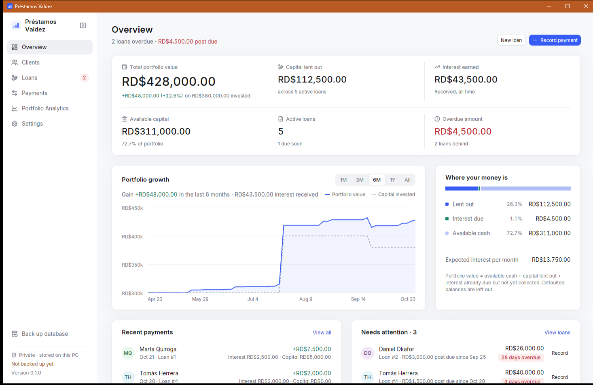
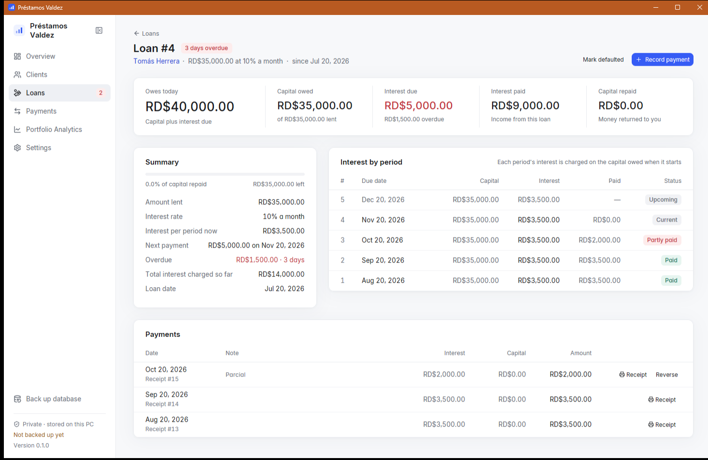
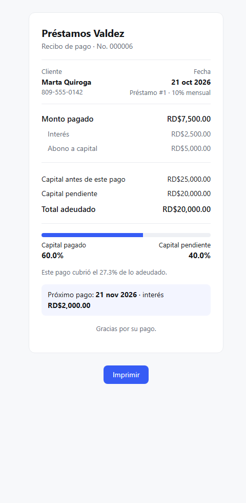

# Acervus Finance

Made by VZ Labs (officialvzlabs@gmail.com). Called "VZ Finance" before version
0.4; from 0.9 the program is `acervus.exe` and the app moves its data folder to
its new place by itself on first start, so upgrades keep your data.

A private, offline Windows desktop app for running a personal lending
portfolio: clients, loans, interest, repayments and the growth of your capital.
Built in Rust with [GPUI](https://gpui.rs) and SQLite.



## What it does

- **Three kinds of loans**:
  - *Installments, declining balance* (the default): the capital is split into
    equal installments and each installment's interest is charged on the
    capital still owed. 10,000 at 10% a month in 5 installments is 3,000,
    2,800, 2,600, 2,400 and 2,200: 13,000 in total.
  - *Flat installments*: interest on the amount lent every period
    (10,000 at 10% in 5 is 3,000 each).
  - *Interest only*: interest each period, capital paid whenever (1,000 at 10%
    is 100; paying 600 leaves 500, so next time it is 50).
- **Any schedule**: payments daily, weekly, every 15 days or monthly, with the
  interest rate quoted per day, week, 15 days or month independently (10% a
  month paid weekly is 2.33% a payment, on a 30-day month). Any number of
  installments. The schedule can be edited before saving (due date, capital,
  interest or total of each installment); edited rows are marked.
- **Late fees**: a configurable percentage (5% by default) of what is still
  unpaid on an installment, charged once, the day after it falls due. Each fee
  is listed on the loan with its base, and can be waived with a reason and
  restored.
- **Three ways to take a partial payment** on an installment loan: against one
  installment, spread over installments (oldest first, or amounts you choose),
  or a custom split between late fees, interest and capital. The app shows
  where every peso goes before you save.
- **Overview**: portfolio value, capital lent out, interest earned, available
  capital, active loans and overdue amount, with a growth chart, where your
  money is, recent payments and loans needing attention.
- **Search and sort**: the Clients and Loans tables have a search box
  (name, ID number, phone, address or notes; loan number, client, amount,
  status, type or rate; case and accents don't matter) and every column
  sorts by clicking its header, again to reverse.
- **Clients**: searchable directory; each client has a profile with loans,
  payment history, totals and notes, and optionally an ID number, an address
  and a photo of the client or their ID (kept private in the database, shown
  only on request, never printed). A new client can also be added from inside
  the New loan form. Clients are archived, never deleted.
- **Payments**: record a payment in a few keystrokes with a live split between
  interest and capital.
- **Two accounts**: available capital and available interest. Loans use
  capital first, then interest; repaid capital goes back to capital, interest
  to interest. **New record** takes income from outside the business or an
  expense, each with a required reason, into or out of either account; you
  can also move money between them, or adjust both to what you really have
  on hand.
- **Everything is editable**: loans, payments, capital, expenses and clients
  can be edited or deleted. Payment splits are recalculated automatically and
  every change is kept in a change history with the old and new values.
- **Printable receipts** on US Letter paper, both with your logo and the
  client details you choose in Settings:
  - a payment receipt: what was paid and where it went, what is still owed,
    every earlier payment on the loan oldest first, and for installment loans
    each installment's status (paid, partly paid, overdue or pending). Open
    (interest-only) loans have no schedule, so their receipts show no due
    dates;
  - a loan receipt: amount, rate, the schedule of an installment loan, how
    payments work and signature lines.

  The signature lines sit at the foot of the page. A long history or long
  custom wording continues on a second page with numbered pages; nothing is
  left out. The "How payments work" lines (one list per loan type), the
  signature captions and the closing lines can be reworded in Settings, and
  the original wording restored at any time.
- **Portfolio Analytics**: returns, capital ledger, monthly interest, capital
  lent out, loans by status and a monthly cash-flow table.
- **Settings**: company name (left empty, receipts say "Acervus Finance"),
  address and phone, with a tick for each to print on receipts, the client
  details to print, receipt wording, a logo (button or drag and drop), English or Spanish,
  currency (Dominican peso by default), number and date formats, default rate,
  payment frequency and late fee, light and dark theme, verified backup and
  restore (with a list of recent backups), CSV export, a "Reset all data"
  button that saves a copy first, and a Diagnostics section showing the
  Windows version and whether the data, backups and receipts folders can be
  written.

Every figure is derived from recorded transactions. The rules (interest,
rounding, payment order, overdue logic, portfolio value) are written down in
[docs/ACCOUNTING.md](docs/ACCOUNTING.md).





## Installing on another PC

Requirements: Windows 10 version 1809 (October 2018) or later, or Windows 11,
64-bit. Nothing else is needed: the C runtime is built in, and the app falls
back to software rendering on PCs without a DirectX 11 graphics driver.

1. Download `AcervusFinance-Setup-<version>.exe` from the latest
   [GitHub Release](https://github.com/xvrobiinson/VZ-Finance/releases).
2. Run it. It installs for the current user without asking for admin rights.
   The app isn't code-signed yet, so SmartScreen may warn: choose
   *More info* → *Run anyway*.
3. Open **Acervus Finance** from the Start menu.

To move your data, use Settings → Back up to… on the old PC, copy the `.db`
file over, and use Settings → Restore from a file… on the new one.

If a button seems to do nothing, open Settings → Diagnostics. It shows whether
the folders can be written and links to the log
(`%LOCALAPPDATA%\VZ Labs\Acervus\logs\acervus.log`), which records errors such as
a file window that couldn't open, never names or amounts. Backups also work
without the file window (Save in backups folder), and a logo can be dragged
onto the logo box.

The Open window (logo, client photo, restore, export folder) always starts in
a folder that exists and keeps its own remembered state. If Windows still
refuses to show it, the app tries again with that state cleared, then
without an owner window, then with the older Windows file window; every
attempt and its error code is logged. Receipts and folders are opened the
same careful way, with Explorer or Edge as a fallback, and a failure is shown
instead of nothing happening.

Tested on Windows 11 Home (build 26300) only. Windows 10 hasn't been tested;
the 1809 minimum follows from what the app needs (DirectX 11 with DXGI 1.6,
available from Windows 10 1803).

## Privacy

No account, no network requests, no telemetry. Data lives in
`%LOCALAPPDATA%\VZ Labs\Acervus\data\portfolio.db`. Installing, upgrading or
uninstalling never touches that folder. The database is not encrypted by the
app; use BitLocker or device encryption for encryption at rest.

## Keyboard

| Action | Keys |
| --- | --- |
| Record payment | Ctrl P |
| New loan | Ctrl L |
| New client | Ctrl N |
| New record (income or expense) | Ctrl E |
| Search clients | Ctrl F |
| Back up | Ctrl S |
| Toggle sidebar | Ctrl B |
| Sections | Ctrl 1 – 6 |
| Back | Alt ← |
| Confirm a dialog | Enter |

## Building

Requirements: Windows 10/11 x64, Rust stable (1.95+), and the MSVC C++ build
tools with a Windows 10/11 SDK (Visual Studio Build Tools, "Desktop development
with C++").

```powershell
cargo run                    # debug build
cargo test                   # calculation engine, database and service tests
powershell -ExecutionPolicy Bypass -File scripts\build-installer.ps1
```

The installer script runs the tests, builds the release binary (static C
runtime, no console window) and produces `dist\AcervusFinance-Setup-<version>.exe`
with [Inno Setup 6](https://jrsoftware.org/isinfo.php)
(`winget install JRSoftware.InnoSetup`).

**Without Visual Studio.** If the Build Tools can't be installed (some
antivirus products block it), the app also builds with LLVM (`clang-cl`,
`lld-link`) and the Microsoft CRT and SDK libraries downloaded by
[xwin](https://github.com/Jake-Shadle/xwin). Point Cargo at them in your
user-level `~/.cargo/config.toml` (`linker`, `CC`, `AR`, `INCLUDE`, `LIB`,
`RC`). Release builds also need `fxc.exe` for GPUI's shaders: set
`GPUI_FXC_PATH` to it, or to any tool that accepts the same arguments.

### Releases

Every push to `main` runs [`.github/workflows/release.yml`](.github/workflows/release.yml),
which formats, audits dependencies (RustSec), lints with Clippy, tests, builds the
installer on Windows and publishes it as a GitHub Release with its SHA-256. A
newer push to `main` cancels the run in progress, so only the latest commit is
released. Commits that only change `README.md` or screenshots, or whose message
contains `[skip ci]`, don't release.

Versions: `Cargo.toml` sets `MAJOR.MINOR`; CI picks the next free patch from the
`v*` tags (0.2.0, 0.2.1, …) and stamps it into the build. Nothing is committed
back. To start a new line, raise the version in `Cargo.toml` (for example to
`0.5.0`).

Code signing is optional: add the repository secrets `WINDOWS_SIGNING_CERT`
(the `.pfx` file, base64-encoded) and `WINDOWS_SIGNING_PASSWORD`, and both the
app and the installer are signed and timestamped.

### Demo data

```powershell
cargo run --example seed_demo -- C:\temp\demo.db
$env:ACERVUS_DB = "C:\temp\demo.db"; cargo run
```

`ACERVUS_DB` points the app at another database file, so your real data is
never touched while testing. The seeder refuses to overwrite an existing file.

## Project layout

```
src/
  main.rs          entry point: logging, assets, window
  lib.rs
  domain/          pure financial logic (money, schedules, accrual, portfolio)
  database/        SQLite setup, migrations, repositories, backup/restore
  services/        validated, transactional operations; settings; CSV export
  app/             root view, navigation, shortcuts, sidebar, dialogs
  ui/              design tokens, components, forms, screens
  charts/          line and column charts drawn with GPUI primitives
  utils/           dates
installer/         Inno Setup script
docs/              accounting rules
examples/          demo data seeder
```

## Licenses

Inter typeface: SIL Open Font License 1.1 (`assets/fonts/Inter-LICENSE.txt`).
Icons: Lucide (ISC), bundled through GPUI Kit.
